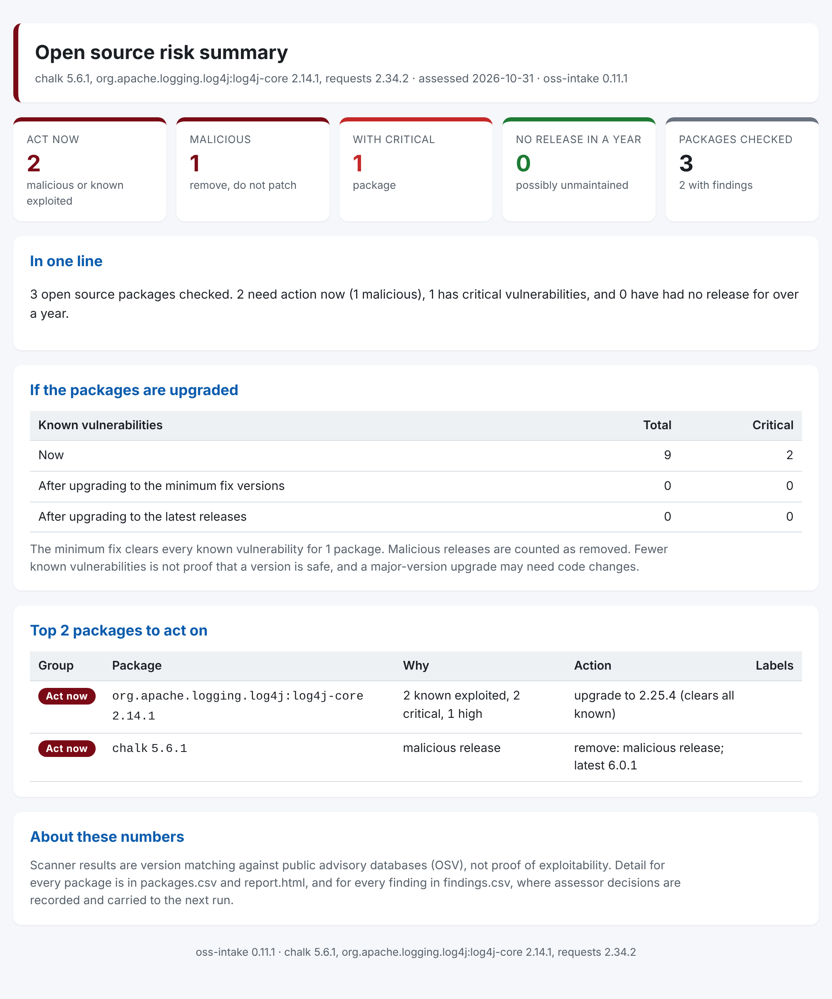
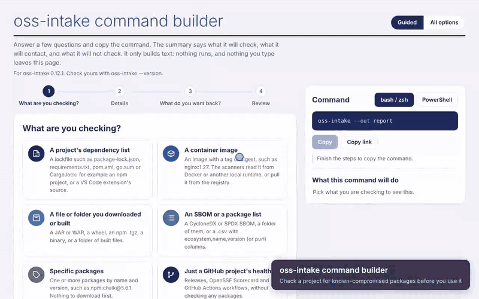

# oss-intake

[](https://github.com/ntavakol/OSS-Intake/actions/workflows/ci.yml)
[](https://github.com/ntavakol/OSS-Intake/actions/workflows/codeql.yml)
[](https://scorecard.dev/viewer/?uri=github.com/ntavakol/OSS-Intake)
[](https://pypi.org/project/oss-intake/)
[](https://www.bestpractices.dev/projects/15943)

**Know which of your open source is malicious, exploited or going stale, and what to do about each one.**

Most of every application is open source, and most organisations check a package once, when it is approved,
and never again. A package that was clean on approval day can turn hostile later: in September 2025 attackers
published malicious releases of chalk, debug and other npm packages downloaded billions of times a week. Log4Shell
is still exploited years after its fix shipped. `oss-intake` checks what you run against public advisory and
exploit data and gives one reading order: remove what is malicious, patch what is being exploited, schedule the
rest.

## Try it in 30 seconds

No scanner, no account and no file needed:

```bash
pipx install oss-intake
oss-intake --package npm:chalk@5.6.1 --package maven:org.apache.logging.log4j:log4j-core@2.14.1 \
  --package pypi:requests@2.34.2 --out demo-report
```

Among its progress and warning lines, it prints a verdict for each package:

```text
findings=9 critical=2 high=1 with_fix=8 fix_before_release=0 fix_date_unknown=0
  chalk 5.6.1 (npm): MALICIOUS release. Remove it.
  org.apache.logging.log4j:log4j-core 2.14.1 (maven): 8 known vulnerabilities, 2 critical, 2 known exploited; upgrade to at least 2.25.4 (clears all known)
  requests 2.34.2 (pypi): no known vulnerabilities
```

`demo-report/executive-summary.html` is the page for someone who will not read a findings list:

<picture>
  <source media="(prefers-color-scheme: dark)" srcset="https://raw.githubusercontent.com/ntavakol/OSS-Intake/main/docs/images/executive-summary-dark.png">
  
</picture>

## Build the command

oss-intake has 70 options; most runs need three. The [command builder](https://ntavakol.github.io/OSS-Intake/builder/)
asks what you are checking and what you want back, then gives the command for bash, zsh or PowerShell and says in
plain words what it will check, what it sends where, and when it fails. It runs in your browser and sends
nothing anywhere.



45 seconds: the questions, copying the command, and the
[report](https://ntavakol.github.io/OSS-Intake/samples/compromised-npm/report.html) for a lockfile of six
compromised npm releases, from a real run of the same command.
[Full-quality video](https://github.com/ntavakol/OSS-Intake/blob/main/docs/videos/builder-demo.mp4).

## The gaps it closes

Questions a security or engineering manager gets asked, and what answering them usually takes:

| The question | Usually | With oss-intake |
|---|---|---|
| Are we running any of the compromised packages in the news? | Someone searches repositories by hand | One run over your package list or SBOMs; malicious releases come first, marked "remove, do not patch" |
| Which of our thousands of findings are actually being exploited? | Scanner output sorted by CVSS | Findings ordered by CISA KEV, public exploits and EPSS; ones that apply only under stated conditions are set apart |
| Has anything changed since we approved it? | Checked once, at approval | A ready-made weekly re-scan that opens an issue when something new needs action, with the assessor's decisions carried between runs |
| What does upgrading buy us, and who has to do it? | A spreadsheet and a lot of chasing | Known vulnerabilities now, after the minimum fix and after the latest release, with totals by owner or team |
| Does this project or vendor actually ship fixes? | Gut feel | Release lag (how long fixes existed upstream before the project shipped them), release cadence and OpenSSF Scorecard |
| Can we block it in the pipeline? | Custom scripts | `--fail-on malicious,kev` exits non-zero, and a check that could not run fails rather than passing |

## What you can point it at

| You have | Run | Scanner needed |
|---|---|---|
| A package name and version | `--package npm:chalk@5.6.1` (repeat it, or give a `pkg:` purl) | No |
| A list of packages, from Artifactory, Nexus or a spreadsheet | `--path packages.csv` | No |
| SBOMs: CycloneDX, SPDX or GitHub's dependency-graph export, one file or a folder | `--path ./sboms` | No |
| Laptops and servers | the [osquery collector](https://github.com/ntavakol/OSS-Intake/tree/main/examples/osquery) makes one SBOM per host | No |
| What a Nexus proxy has cached | the [Nexus collector](https://github.com/ntavakol/OSS-Intake/tree/main/examples/nexus) | No |
| An R `renv.lock` | `--path renv.lock` | No |
| A lockfile: npm, Python, Maven, Go, Rust, PHP, Ruby or .NET | `--path package-lock.json` | Trivy |
| A JAR, WAR, EAR or binary, also checked against the registry's published checksum | `--path app.jar` | Trivy |
| A container image | `--image owner/app:1.2.3` | Trivy (Grype optional) |
| A GitHub project | `--repo owner/name`: alone for project health; with an image, artifact or lockfile, also release lag | No |

It is free and open source (Apache-2.0) and runs on Windows, macOS or Linux with Python. Your files are read
where they are: what leaves the machine is package names and versions, vulnerability IDs and, with `--repo`, the
repository name, sent to public services such as OSV, deps.dev, the package registries, FIRST EPSS, OpenSSF
Scorecard and GitHub (with your `GITHUB_TOKEN`, if set, sent only to api.github.com). It does not prove a vulnerability is exploitable in your environment, and it says so in
every report; see [What it does not do](#what-it-does-not-do) below.

## Install

Python 3.10 or later on Windows, macOS or Linux. No administrator rights are needed.

```bash
pipx install oss-intake
```

On Windows without pipx: `py -m pip install --user pipx`, then `py -m pipx ensurepath`, open a new terminal and
run `pipx install oss-intake`. Container images, lockfiles and built files are scanned with
[Trivy](https://github.com/aquasecurity/trivy) (and [Grype](https://github.com/anchore/grype) if you have it);
package names, package lists and SBOMs need no scanner. The [guide](https://github.com/ntavakol/OSS-Intake/blob/main/docs/guide.md#install)
shows how to install the scanners pinned and verified, and how to verify an oss-intake release.

## What it does not do

- **It does not prove exploitability.** Scanners match component versions against advisory databases. A
  finding means a version is listed as affected, not that the vulnerable code is reachable or exposed in your
  deployment. The CSV has `triage_*` columns for the assessor's decisions, which carry over to the next run.
- It does not install, download, bundle or redistribute scanners. You install them; it verifies them.
- It does not assess licences, secrets or misconfiguration, and it does not detect new malware. Package versions
  already known as malware are flagged as malicious: listed in the OpenSSF malicious packages database (OSV `MAL-`
  entries), or covered by an advisory classed as embedded malicious code (CWE-506), as the compromised
  ua-parser-js 0.7.29 and event-stream 3.3.6 releases are.
- It does not give a risk rating. The likelihood suggestion is a starting point for an assessor.
- It does not fix anything or open issues upstream.

## Learn more

- [Admin guide](https://github.com/ntavakol/OSS-Intake/blob/main/docs/admin-guide.md): step by step with the command builder, for each common check (an
  image, a lockfile, a downloaded file, an SBOM or package list, single packages, a project's health, a CI gate).
- [The guide](https://github.com/ntavakol/OSS-Intake/blob/main/docs/guide.md): every option, package inventories and SBOMs,
  the collectors, how release lag and triage work, carrying decisions between runs, the likelihood heuristic and
  the limitations.
- [Command builder](https://ntavakol.github.io/OSS-Intake/builder/) and the
  [live sample report](https://ntavakol.github.io/OSS-Intake/samples/compromised-npm/report.html).
- [Weekly re-scan](https://github.com/ntavakol/OSS-Intake/tree/main/examples/scheduled-rescan): a ready-made GitHub
  workflow that opens an issue when something new needs action.
- [How the code is put together](https://github.com/ntavakol/OSS-Intake/blob/main/docs/architecture.md), [planned work](https://github.com/ntavakol/OSS-Intake/blob/main/BACKLOG.md),
  [contributing](https://github.com/ntavakol/OSS-Intake/blob/main/CONTRIBUTING.md), [security](https://github.com/ntavakol/OSS-Intake/blob/main/SECURITY.md) and the [changelog](https://github.com/ntavakol/OSS-Intake/blob/main/CHANGELOG.md).

## Licence

Apache License 2.0. See [LICENSE](https://github.com/ntavakol/OSS-Intake/blob/main/LICENSE).
