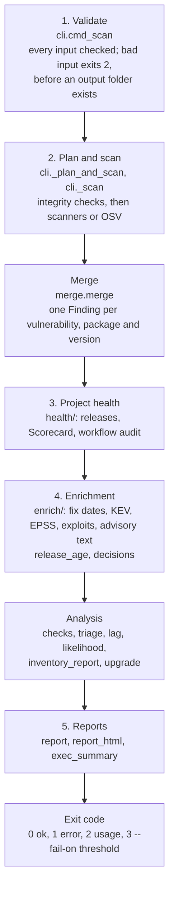

# Architecture

How oss-intake is put together, for people who want to change it. Usage is in the
[README](https://github.com/ntavakol/OSS-Intake#readme); the rules for contributing are in
[CONTRIBUTING.md](https://github.com/ntavakol/OSS-Intake/blob/main/CONTRIBUTING.md).

## In one paragraph

oss-intake is a command-line tool with no server and no database. One run reads an input (a container image,
a file, a package list or SBOMs, or single `--package` values), turns everything it learns into a list of
`Finding` objects, merges findings that describe the same vulnerability, adds evidence from public services,
groups them into a reading order, and writes reports to an output folder. The runtime depends on `requests`
only. External scanners (Trivy, Grype, govulncheck) are separate programs the user installs; oss-intake
verifies them and runs them, but never downloads or bundles them.

## The pipeline

The numbers match the stage comments in `src/oss_intake/cli.py`.

1. **Validate** (`cmd_scan`). Every argument and input file is checked before any network call or scan:
   `inputs.classify` decides what `--path` is, `inputs.inventory` and `inputs.packages` validate every row or
   `--package` value, and gates that could not be evaluated are refused here. A bad input exits 2 with every
   problem listed, and no output folder is left behind.
2. **Plan and scan** (`_plan_and_scan`, `_scan`). Sets up the response cache, checks an artifact's checksum
   against its registry (`registry_check`), then gets findings: by running Trivy and Grype (each binary checked
   first by `integrity`), by loading saved scanner JSON (`--from-trivy-json`, `--from-grype-json`), or, for
   package lists, SBOMs, `renv.lock` and `--package`, by asking OSV directly. A scanner failure stops the run,
   because a partial scan would read as a clean one.
   - **Merge** (`merge.merge`). Findings from several sources become one row per vulnerability, package and
     version, recording which sources saw it.
3. **Project health** (`health/`). With `--repo`: release cadence and the release used for lag
   (`health.releases`), OpenSSF Scorecard (`health.scorecard`), and an audit of the project's GitHub Actions
   workflows (`health.workflows`).
4. **Enrichment** (`enrich/`, `release_age`, `decisions`). Fix publication dates from deps.dev and the distro
   sources, CISA KEV, EPSS, exploit evidence (Metasploit, Nuclei, Exploit-DB, GitHub proofs of concept), advisory
   text and conditions, release dates of the package versions, and the assessor's decisions from an earlier run.
   - **Analysis**. `checks` records which sources actually ran, so a skipped check is shown as "not checked",
     never as a zero. `triage` gives each finding a suggested group, `lag` measures release lag, `likelihood`
     runs the optional 5x5 heuristic, and for package lists `inventory_report` and `upgrade` build the per-package
     rows and the upgrade comparison.
5. **Reports** (`report`, `report_html`, `exec_summary`). `findings.csv`, `summary.md`, `assessment.json` and a
   self-contained `report.html`; for package lists also `packages.csv` and `executive-summary.html`. Then the
   `--fail-on` gates decide the exit code.

## Modules

| Area | Modules | Responsibility |
|---|---|---|
| Entry and pipeline | `cli.py`, `__main__.py` | Arguments, the `scan`, `doctor` and `verify` commands, the stages above, gates and exit codes |
| Inputs | `inputs.py`, `sbom.py`, `os_packages.py` | What a path is, inventory and `--package` validation, SBOM reading, OS packages to OSV ecosystems |
| Scanners | `scanners/trivy.py`, `scanners/grype.py`, `scanners/osv.py`, `scanners/govulncheck.py` | Run a tool or query OSV, and turn its output into `Finding` objects |
| Integrity | `integrity.py`, `registry_check.py`, `data/known_bad.json` | Scanner version pins, SHA-256 and cosign checks, known-bad versions; artifact checksums against registries |
| Model and merge | `models.py`, `merge.py`, `versions.py`, `cvss.py` | The `Finding` dataclass, merge keys, version comparison, CVSS parsing |
| Enrichment | `enrich/*.py`, `release_age.py`, `decisions.py` | Evidence from public services; package release dates; assessor decisions and OpenVEX |
| Health | `health/releases.py`, `health/scorecard.py`, `health/workflows.py` | Project activity, Scorecard, workflow audit |
| Analysis | `checks.py`, `triage.py`, `conditions.py`, `reachability.py`, `lag.py`, `likelihood.py`, `coverage.py` | Check states, reading order, advisory conditions, Go reachability, release lag, the likelihood heuristic, fix-date coverage |
| Package lists | `inventory_report.py`, `upgrade.py`, `exec_summary.py` | Per-package rows, upgrade comparison, the executive summary |
| Output | `report.py`, `report_html.py` | CSV, Markdown, JSON, VEX and HTML reports |
| Network | `http.py` | The `Http` interface, `RequestsHttp`, the response cache and parallel prefetch |

## The data model

Everything between scanning and reporting works on a list of `models.Finding`: one vulnerability in one
package version, with its severity, fixed versions, sources, and every field the later stages fill in
(fix publication date, KEV, EPSS, exploit level, triage group, decision). Each stage adds to the findings in
place and returns a small statistics dictionary, which ends up in `assessment.json`.

**Merge key.** `Finding.merge_key()` is `(canonical ID, package, installed version)`:

- The canonical ID (`models.canonical_id`) prefers a CVE among the ID and its aliases, then a GHSA ID, so that
  Trivy (which reports CVEs) and Grype (often GHSA) merge, and an OSV malicious-package entry (`MAL-`) merges
  with the GitHub advisory it aliases.
- The package is the package URL without its version, percent-decoded (OSV and Trivy encode an npm scope
  differently), or `type:name` when there is no package URL. An OS package read from an SBOM keeps its distro
  qualifier, so the same package in two distro releases stays two rows.

When findings merge, `merge.py` keeps the highest severity any source reported, the best CVSS score, the union of
aliases, sources and fixed versions, the earliest publication date, and every location the finding was seen in.

**Malicious packages** are findings too. A malicious finding on a package version marks every finding on that
version (`malicious_package`), because other advisories for the same malware often do not alias its `MAL-` ID.

## The network layer

All network access goes through the `http.Http` interface: `get_json`, `post_json`, `get_text` and `prefetch`.
Nothing else in the code imports `requests`.

- **`RequestsHttp`** is the real one. It sets the user agent, sends `GITHUB_TOKEN` only to `api.github.com`,
  and never puts a token in an error message.
- **`ResponseCache`** keeps successful answers that change slowly on disk for a limited time: OSV advisory
  details for a day, deps.dev release dates for 30 days, latest versions for a day, proof-of-concept lists for
  7 days. What affects a version (the OSV query itself), KEV, EPSS and the exploit indexes are always fetched
  fresh, and "not found" is never cached. A cache folder other users can write to is not used, with a warning,
since its answers could have been planted.
- **`prefetch(urls)`** fetches a known list of URLs a few at a time in parallel (8 workers). The calls that
  follow are answered from memory, so the code that uses the results stays sequential.
- **Tests** pass their own `Http` to `cli.main(argv, http=...)`. `tests/conftest.py::FakeHttp` routes URLs to
  files in `tests/fixtures` and fails the test on any URL it does not know, so no test can reach the network.

## Extension points

**A new scanner.** Add `scanners/<name>.py` with a function that turns the tool's output into
`list[Finding]` (set `sources={"<name>"}` and a package URL where the tool gives one). Wire it into
`cli._scan` and `_resolve_scanners`, add a `--from-<name>-json` option if the tool can save its output (tests
depend on this), and add its version pins and known-bad entries to `integrity.py` and `data/known_bad.json` if it
is an executable. For text fields such as the title and URL, the first source to report one keeps it, and
`_scan` adds sources in the order Trivy, Grype, OSV.

**A new enricher.** Add `enrich/<name>.py` with `enrich(http, findings) -> dict`: prefetch the URLs it needs,
fill fields on the findings in place, and return counts (looked up, found, errors) for `assessment.json`. Call
it from the enrichment stage in `cli._assess`, add a route for its URLs to `FakeHttp`, and, if a failure could
make a result look clean, record it in `checks.py` so the reports say "not checked".

**A new input source (collector).** Prefer a small standalone script in `examples/` that writes a CycloneDX
SBOM or an inventory CSV, as `examples/osquery`, `examples/nexus` and the recipes in `examples/sbom` do. The
core then reads it like any other SBOM, needs no vendor API keys, and the scanning code does not change.
Collectors use the Python standard library only, and their SHA-256 sums are listed in the README (a test keeps
them current).

**A new report field.** Add the field to `Finding` or to the statistics dictionary that produces it, then to
`report.py` (CSV, Markdown, JSON) and `report_html.py`. Parts of the README are generated from the reports: run
`python scripts/readme_sync.py` afterwards, or the tests fail.

## Design rules that shape the code

- **Validate before working.** Inputs are checked in full before the first network call, so a typo costs
  seconds, not a scan.
- **Never report a check that did not run as a clean result.** `checks.py` tracks every source's state; a gate
  whose check did not run fails, and one whose check is turned off is refused.
- **Verify before executing.** A scanner binary is checked against its pinned hash, signature and the known-bad
  list before it runs.
- **One way to the network.** Everything goes through `Http`, which keeps tokens to their own host and makes
  every test offline.
- **Cross-platform.** `pathlib` everywhere, subprocess arguments as lists, explicit file encodings. CI runs on
  Linux, macOS and Windows.
