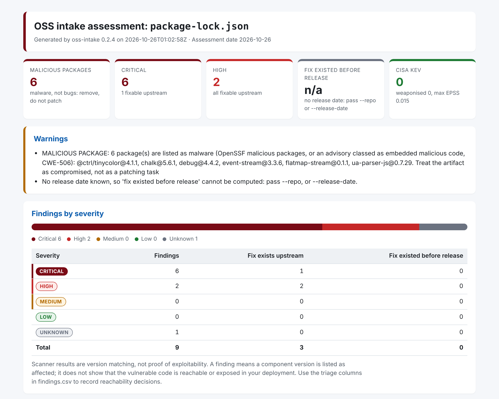

# oss-intake guide

The reference for the engineers who run oss-intake: installing it and the scanners, every option, the inputs it
reads, and how its numbers are worked out. The [README](https://github.com/ntavakol/OSS-Intake#readme) is the
short introduction, the [command builder](https://ntavakol.github.io/OSS-Intake/builder/) writes a command for
you, and the [admin guide](admin-guide.md) walks through the common checks step by step.

- [What it answers](#what-it-answers)
- [What it does](#what-it-does)
- [Install](#install)
- [Usage](#usage)
- [How release lag is measured](#how-release-lag-is-measured)
- [Example output](#example-output)
- [Exploit availability and advisory conditions](#exploit-availability-and-advisory-conditions)
- [Go reachability (optional)](#go-reachability-optional)
- [Suggested triage](#suggested-triage)
- [Carrying decisions between runs](#carrying-decisions-between-runs)
- [Likelihood heuristic](#likelihood-heuristic)
- [Limitations](#limitations)

## What it answers

1. **Is any of it malicious?** Package versions known as malware, from the OpenSSF malicious packages
   database or advisories classed as embedded malicious code.
2. **Is it vulnerable, and what matters first?** Known vulnerabilities in a container image, an artifact or a
   lockfile, with exploit evidence and a suggested triage group for each.
3. **Does the project patch?** Whether fixes that exist upstream are being shipped, how long they have been
   available, and how active the project is.

The third question is what a scanner alone does not answer. `oss-intake` measures **release lag**: findings
where the fixed version of a dependency was already published before the project's release, so the project
could have shipped it and did not. It then adds project health signals (release cadence, OpenSSF Scorecard,
CISA KEV membership).

## What it does

- Runs [Trivy](https://github.com/aquasecurity/trivy) and, if installed, [Grype](https://github.com/anchore/grype)
  against an image, and queries [OSV.dev](https://osv.dev) for the language packages Trivy found.
- Merges the results into one row per vulnerability, package and version, recording which sources saw it.
- Looks up when each fixed dependency version was published ([deps.dev](https://deps.dev)) and compares that
  with the project's GitHub release date.
- Reports release cadence from the GitHub API and the OpenSSF Scorecard score where one exists.
- Audits the project's own GitHub Actions workflows: unpinned actions, known-bad action versions (such as the
  compromised `trivy-action` tags), missing or write-all token permissions, and `pull_request_target` triggers.
- Optionally suggests a likelihood value for a 5x5 risk matrix from configurable rules, clearly labelled
  as a heuristic.
- Checks the open source an organisation already runs: a package inventory CSV or a folder of SBOMs, one per
  host, image or repository (an [osquery](https://github.com/ntavakol/OSS-Intake/tree/main/examples/osquery)
  collector makes them for laptops and servers), with each package version looked up once and counted per
  system.
- Writes `findings.csv`, `summary.md`, `assessment.json` and a self-contained `report.html`, plus the raw
  scanner output under `raw/` as evidence. Reports the last run left in the folder that this run did not write
  are removed (only files listed in its `.oss-intake-files.json`; other files are left alone), and a symbolic
  link where a report goes stops the run.
- Applies integrity checks to the scanners it runs: version pinning, a known-bad version list, SHA-256
  verification and optional Sigstore (cosign) verification.
- Checks itself: a weekly [self-check](https://github.com/ntavakol/OSS-Intake/blob/main/.github/workflows/self-check.yml)
  job runs oss-intake on every package it installs (its runtime and its hash-pinned dev tools) and fails on a
  malicious, known exploited or high severity finding.

## Install

Python 3.10 or later on Windows, macOS or Linux. No administrator rights are needed.

```bash
pipx install oss-intake
```

Releases are published to PyPI from GitHub Actions through trusted publishing, so PyPI shows each file's
provenance (which workflow in this repository built it). Each GitHub release also carries a Sigstore signature
bundle (`.sigstore.json`) for every file, verifiable with
[sigstore-python](https://github.com/sigstore/sigstore-python). From 0.12.1 it also carries a CycloneDX SBOM of the
release (`oss-intake-<version>.cdx.json`), signed like the other files: oss-intake with the wheel's SHA-256, and
the runtime dependencies it was built and tested with. To check a download and the SBOM, then check the SBOM with
oss-intake itself:

```bash
pip install sigstore
for f in oss_intake-0.16.0-py3-none-any.whl oss-intake-0.16.0.cdx.json; do
  python -m sigstore verify identity --bundle "$f.sigstore.json" \
    --cert-oidc-issuer https://token.actions.githubusercontent.com \
    --cert-identity https://github.com/ntavakol/OSS-Intake/.github/workflows/release.yml@refs/tags/v0.16.0 "$f"
done
oss-intake --path oss-intake-0.16.0.cdx.json --out sbom-check
```

The SBOM lists the versions resolved when the release was built; installing later may resolve newer ones within
the declared ranges.

From 0.16.0 each release also carries SLSA build provenance (`oss-intake-<version>.intoto.jsonl`, SLSA level 3,
made by the [SLSA GitHub generator](https://github.com/slsa-framework/slsa-github-generator)) for the wheel, the
source archive and the SBOM: a signed record of which workflow, commit and tag built them. To check a download
with [slsa-verifier](https://github.com/slsa-framework/slsa-verifier) (`brew install slsa-verifier`), in the
folder holding the release files:

```bash
V=$(oss-intake --version | awk '{print $NF}')
for f in "oss_intake-$V-py3-none-any.whl" "oss_intake-$V.tar.gz" "oss-intake-$V.cdx.json"; do
  slsa-verifier verify-artifact "$f" --provenance-path "oss-intake-$V.intoto.jsonl" \
    --source-uri github.com/ntavakol/OSS-Intake --source-tag "v$V"
done
```

Windows PowerShell without pipx:

```powershell
py -m pip install --user pipx
py -m pipx ensurepath
# open a new terminal, then
pipx install oss-intake
```

If `oss-intake` is "not recognized" after `pip install --user`, the per-user Scripts folder is not on PATH.
Either add it, or run the tool through Python, which works everywhere:

```powershell
py -m oss_intake --help
```

### Install the scanners yourself, pinned and verified

Install a specific version of each scanner from its official GitHub release, never "latest", and verify the
download before you extract it. `oss-intake verify` does the hash comparison correctly on any platform
(checksum files are served as `application/octet-stream`; they are parsed as bytes, with BOM and CRLF handled):

```bash
oss-intake verify --file trivy_0.76.1_windows-64bit.zip --checksums trivy_0.76.1_checksums.txt
```

Then record the SHA-256 of the extracted executable and pass it on every run (`oss-intake doctor` prints it):

```bash
oss-intake doctor
```

Or keep the release files and let each run check the whole chain before the scanner executes: the cosign
signature on the checksums file, the archive's SHA-256 in it, and the executable byte-for-byte against the one in
the archive. Trivy and Grype both sign their checksums file (Trivy also each archive); neither signs the
extracted executable. Without the bundle, the checks still run, but the report says the hash is not verified:
whoever could swap the archive could swap a checksums file nothing has signed.

```bash
oss-intake --image owner/app:1.2.3 --out ./reports --trivy-version 0.76.1 \
  --trivy-archive trivy_0.76.1_Linux-64bit.tar.gz --trivy-checksums trivy_0.76.1_checksums.txt \
  --trivy-cosign-bundle trivy_0.76.1_checksums.txt.sigstore.json
```

Trivy versions 0.69.4, 0.69.5 and 0.69.6 were malicious (CVE-2026-33634, March 2026). `oss-intake` refuses to
run any version on its [known-bad list](https://github.com/ntavakol/OSS-Intake/blob/main/src/oss_intake/data/known_bad.json).
It reads the version from the binary's Go build information first, so a known-bad release is refused without
being run, even with no pinned hash. A build with no version recorded (some source builds) is still run once
with `--version` and checked then; pin the hash to avoid that.

## Usage

```bash
oss-intake --image owner/app:1.2.3 --repo owner/app --out ./reports \
  --image-src remote --trivy-version 0.76.1 --trivy-sha256 <sha256-of-trivy-executable> --likelihood
```

PowerShell (backtick continues a line):

```powershell
$env:GITHUB_TOKEN = "<optional token, raises the GitHub API rate limit>"
oss-intake --image owner/app:1.2.3 --repo owner/app --out .\reports `
  --image-src remote --trivy-version 0.76.1 --trivy-sha256 <sha256> --likelihood
```

Without a container image, assess a file or folder directly with `--path`:

```bash
oss-intake --path ./vendor-app-2.4.1.jar --repo owner/app --out ./reports   # JAR, WAR, EAR or binary
oss-intake --path ./requirements.txt --repo owner/app --release-tag v1.4.0 --out ./reports
oss-intake --path ./renv.lock --repo owner/app --release-tag v1.4.0 --out ./reports
```

A JAR, WAR, EAR or binary is scanned as built artifacts (Trivy `rootfs`, Grype `dir:`), and a version in its
file name is tried as the release tag. A JAR, WAR or EAR, a Python wheel or sdist, or an npm `.tgz` is also
compared with the checksum its registry publishes for that exact version: Maven Central (coordinates from the
archive's `pom.properties`; the strongest of SHA-512, SHA-256 and SHA-1 it publishes), PyPI (SHA-256) or npm
(SHA-512). A mismatch means the file is not the one the project released (rebuilt, repackaged or tampered with)
and leads the report; a match proves only that the file is the published one, not that it is safe. A fat JAR
that bundles several projects cannot be checked this way. `--no-registry-check` or `--offline` skips it. Lockfiles the scanners understand (Python, npm, Maven, Go, Rust, PHP,
Ruby, .NET) are scanned with Trivy `fs`. An R `renv.lock` is read by oss-intake and checked against OSV's CRAN
advisories, since neither scanner reads it; packages from Bioconductor, GitHub or local sources are listed as
not checked. A folder is scanned as built artifacts; for a source checkout, pass its lockfile. Release lag needs
the project's release: `--repo` with `--release-tag`, or `--release-date`.

### VS Code extensions

```bash
oss-intake --path ./extension.vsix --out ./reports
oss-intake --path ~/.vscode/extensions --out ./reports --fail-on malicious   # everything installed
```

To check an extension before installing it, download its `.vsix` from VS Code (open its page in the Extensions
view, click the gear icon next to Install, Download VSIX); downloading runs nothing.

A `.vsix` (recognised by its content: a zip with `extension/package.json`), an installed extension's folder, or a
folder of them (`~/.vscode/extensions`, and the same layout in Cursor, VSCodium and Windsurf) is checked as
extensions. There is no vulnerability database for extensions, so oss-intake reports what can be known:

- **The VS Code Marketplace removal list** ([RemovedPackages.md](https://github.com/microsoft/vsmarketplace/blob/main/RemovedPackages.md),
  fetched from raw.githubusercontent.com; nothing is sent). An extension removed as Malware or Potentially
  malicious leads the report and counts for `--fail-on malicious`; one removed for Impersonation, Typo-squatting,
  Untrustworthy or Spam is a warning. If the list cannot be fetched, or with `--offline`, the report says it was
  not checked, and `--fail-on malicious` exits 1 rather than passing.
- **The npm packages it ships**, scanned with Trivy `rootfs` and checked against OSV like any other. Each finding
  is matched to the extensions that ship that package version (oss-intake reads every `node_modules` in them, since
  the scanners do not say where in the folder a package is), or to the extension whose shipped SBOM or lockfile
  lists it (Pylance, for one, ships SPDX SBOMs of its bundled tools), and the report counts them per extension. An
  extension whose code is bundled into one file (a large main file) hides its own dependencies; the report says
  so, even when it also ships packages the scanners see.
- **Old versions** that VS Code has replaced but not yet deleted (listed in the extensions folder's `.obsolete`
  file, which is read only there, never inside an extension) are marked as not in use: checked against the removal
  list, left out of the indicator tables and warnings.
- **Behaviour indicators** in its own files (not its dependencies, which the scanners cover), each with the file
  and line: `activationEvents` `*` or `onStartupFinished`; native programs or libraries, WebAssembly included
  (by name and by their first bytes); `child_process`; `eval` or `new Function`; runs of four or more Unicode
  variation selectors or zero-width characters, or tag characters other than an emoji flag (how GlassWorm hid its
  code); text-reordering characters (Trojan Source); base64 or hex strings of 2,000 characters or more (not an
  image or font `data:` URI); `extensionDependencies` and `extensionPack`; and a folder name or `.vsix`
  manifest that names a different extension from `package.json` (each name is looked up in the removal list);
  and a `main` that leads out of the extension's folder with `..`, as that file is not read.
  Every text file of the extension's own is read, whatever its name, except source maps; the top-level
  `node_modules` is left to the scanners. The web addresses in its code are listed too. These are signals for a
  person to read, not verdicts.
- **The repository it claims** in `package.json` is shown, not checked: a malicious extension can name a
  well-known project. Give `--repo` to check a project you trust.

Nothing in an extension is run. A `.vsix` is unpacked into a temporary folder, removed afterwards, with limits:
at most 50,000 files, 300 MB a file and 1 GB in all (counted as written), no member over 1 MB that expands more
than 200 times, no links, no names that could leave the folder on any system (a root, a drive or colon, `..`,
a part ending in a dot or space, a reserved Windows name) and no two names that are one file on macOS or Windows.
One that breaks a limit, or is damaged, is refused (exit 2) before anything is written. The Marketplace
signature is not checked. `--fail-on mismatch` is refused, as for a folder. The details are in the
[threat model](threat-model.md).

### Package inventory

To check the open source an organisation already uses, pass a CSV list of packages, for example exported from
Artifactory or Nexus, or kept in a spreadsheet (save it from Excel as "CSV UTF-8"):

```bash
oss-intake --path ./packages.csv --out ./reports
```

To re-scan it every week and get an issue when something new needs action, copy the ready-made GitHub workflow in
[examples/scheduled-rescan](https://github.com/ntavakol/OSS-Intake/tree/main/examples/scheduled-rescan).

```csv
ecosystem,name,version,owner,system
npm,@ctrl/tinycolor,4.1.1,Web team,Customer portal
pypi,django,3.2.0,Data team,Reporting
maven,org.apache.logging.log4j:log4j-core,2.14.1,Platform team,Payments
```

Use either `ecosystem`, `name` and `version` columns, or one `purl` column (`pkg:npm/chalk@5.6.1`). Ecosystems:
npm, pypi, maven (`group:artifact`), go, nuget, cargo, gem, composer, cran, hex and pub, plus common aliases
such as python or java. Versions must be exact: ranges such as `^1.2` or `latest` are rejected. Any other
column (owner, system, host, team...) is carried through to the reports as a label; a column named like one
oss-intake fills in (`systems`, `findings`, `group`...) is refused with its name. Every row is validated first:
if any row is invalid, the run stops and lists each problem with its row number, before anything is looked up.
A file may hold up to 500,000 rows, one per host and package if you like: each package version is looked up
once however many rows list it.

No scanner is needed: each package version is checked against OSV, so malicious releases are flagged as well as
vulnerable ones. Besides the usual reports, `packages.csv` lists every package, worst first, with its findings
and label columns, `systems` (how many hosts, images or repositories list it, from a `host`, `hostname` or
`system` column or the SBOM subjects; between equally bad packages, the one on more systems comes first), and an
upgrade comparison:

- **Upgrade to at least:** the lowest version that fixes every listed vulnerability with a fix, and what is
  still known to affect that version (`1.2.0 · 1 known` means the minimum fix is not enough on its own).
- **Latest release:** the package's current release on deps.dev and what is known to affect it. Skip this lookup
  (one request per package) with `--no-latest` to see the current state and the minimum fix only.
- **major:** the upgrade crosses a major version, or a minor version below 1.0, so expect breaking changes.

When a package is on more than one system, `package-systems.csv` lists every package and system pair, so "which
hosts run X" is a filter in a spreadsheet; long host lists are shortened elsewhere (Excel holds 32,767
characters in a cell).

Fewer known vulnerabilities is not proof that a version is safe: it may be less studied, or newer than the
advisories. The HTML report shows the packages that need attention.

Inventory runs also write `executive-summary.html`: one page for someone who will not read the findings. It
gives the packages checked, how many need action now (malicious or known exploited), have critical
vulnerabilities, or have had no release for over a year; the top packages to act on with the action for each;
totals by owner (from an `owner`, `team`, `system` or `application` column); and the known vulnerabilities now,
after upgrading to the minimum fixes, and after upgrading to the latest releases. When `--decisions` points at
the previous run's `findings.csv`, it also shows what changed since then: new findings and findings no longer
present. Run it on a schedule: a package that was clean when approved can turn
out vulnerable or compromised later. A sample is in
[examples/inventory](https://github.com/ntavakol/OSS-Intake/blob/main/examples/inventory/packages.sample.csv).

### SBOMs

An SBOM works wherever an inventory CSV does: a CycloneDX (1.2 to 1.7) or SPDX (2.2, 2.3) JSON file, or a folder
that holds only SBOMs (one per host, image or repository). It is recognised by its content, and GitHub's
dependency-graph export is read as is.

```bash
oss-intake --path ./sboms --out ./reports --label owner="Platform team"
```

Each component is read by its package URL. Language packages are checked as in an inventory. OS packages (deb,
rpm, apk) are checked in OSV under the distro's own ecosystem and release (Ubuntu, Debian, Alpine, Rocky Linux,
AlmaLinux, Wolfi, Chainguard) and by source package, as the distro files its advisories: `libssl3t64` is looked
up as `openssl`. Components that cannot be checked (no package URL, a version range, an OS package whose release
the SBOM does not state, or a distro OSV has no data for, such as Amazon Linux) are listed in the report with the
reason, never counted as clean. The SBOM's subject becomes the `system` label and a component's supplier the
`supplier` label; `--label key=value` adds your own to every package. Recipes for Amazon Inspector, Syft, Trivy
and the GitHub dependency graph are in
[examples/sbom](https://github.com/ntavakol/OSS-Intake/tree/main/examples/sbom).
For laptops and servers, [examples/osquery](https://github.com/ntavakol/OSS-Intake/tree/main/examples/osquery)
turns osquery's package tables, from one machine or a whole fleet's result logs, into one SBOM per host.
[examples/nexus](https://github.com/ntavakol/OSS-Intake/tree/main/examples/nexus) does the same for what a Nexus
Repository proxy has cached, with a gate recipe that checks only what is new since the last run.

### Collectors: in the repository, not the package

The collectors are small standalone scripts (Python standard library only), kept in the repository rather than
the PyPI package, so they can be copied to the machine that needs one (an osquery log server, a host that can
reach Nexus) without installing anything. Get the ones matching your oss-intake version, and check them:

```bash
V=$(oss-intake --version | awk '{print $NF}')    # e.g. 0.16.0
BASE=https://raw.githubusercontent.com/ntavakol/OSS-Intake/v$V/examples
curl -fsSLO "$BASE/nexus/nexus_sbom.py"
curl -fsSLO "$BASE/osquery/osquery_sbom.py"
curl -fsSLO "$BASE/osquery/oss-intake-pack.conf"
shasum -a 256 -c <<'SUMS'
79eff58018a09f1e1599ee9d1723af815794f5109b1b53be11629af4f513cd89  nexus_sbom.py
0fbaa9d99d2714337a2bbc286543f7a47153ba878edde0edd87dee0697307bd7  osquery_sbom.py
b5dfa634d47e15ed06bed1118b40cef9ea02c78c8da2da7ed80c1546567e1a93  oss-intake-pack.conf
SUMS
```

The checksums above are for this release (on Linux without `shasum`, use `sha256sum -c`). Each script's
`--help`, and the README next to it on GitHub, says how to use it:
[examples/nexus](https://github.com/ntavakol/OSS-Intake/tree/main/examples/nexus) (with the gate recipe),
[examples/osquery](https://github.com/ntavakol/OSS-Intake/tree/main/examples/osquery),
[examples/sbom](https://github.com/ntavakol/OSS-Intake/tree/main/examples/sbom) (recipes, no script) and
[examples/scheduled-rescan](https://github.com/ntavakol/OSS-Intake/tree/main/examples/scheduled-rescan) (a
GitHub Actions workflow).

All inputs are validated before any scanner runs. The image must carry an explicit tag or digest.

| Option | Purpose |
|---|---|
| `--out` | Output directory (required) |
| `--image` | Image with explicit tag or digest |
| `--package ECOSYSTEM:NAME@VERSION` | Check one package version, no scanner needed (repeatable): `npm:chalk@5.6.1`, `pypi:django@2.2.0`, `maven:org.apache.logging.log4j:log4j-core@2.14.1`, or a package URL; prints a one-line verdict per package |
| `--path` | A JAR, WAR, binary, folder, lockfile, `renv.lock` or package inventory `.csv` instead of an image |
| `--reachability`, `--govulncheck-path` | Check Go binaries with govulncheck (see Go reachability) |
| `--govulncheck-sha256`, `--govulncheck-version` | Pin govulncheck like the scanners: hash checked before it runs, version after. The Docker or crane executable used to copy binaries out of an image is recorded with its SHA-256 in assessment.json |
| `--repo` | GitHub `owner/name` (a full GitHub URL is accepted) |
| `--image-src remote` | Pull from the registry without Docker installed (Trivy `--image-src remote`, Grype `registry:`) |
| `--platform` | Image platform for both scanners (default `linux/amd64`, so Apple Silicon scans the same variant as a server); `''` uses scanner defaults |
| `--scanners` | `auto` (default: Trivy and OSV, plus Grype if found) or a list such as `trivy,grype,osv` |
| `--trivy-version`, `--grype-version` | Required scanner version; the run fails on mismatch |
| `--trivy-sha256`, `--grype-sha256` | Expected SHA-256 of the executable, checked before it is run at all |
| `--trivy-archive`, `--grype-archive` | The release archive the executable came from; the executable must be byte-for-byte the one inside it |
| `--trivy-checksums`, `--grype-checksums` | The release checksums file, which must list the archive's SHA-256 |
| `--trivy-cosign-bundle`, `--grype-cosign-bundle` | Verify the release's Sigstore bundle with cosign (on PATH): against the checksums file when given, otherwise the archive. Trivy signs its archives and checksums file, Grype only its checksums file; neither signs the extracted executable, so a bundle needs the archive |
| `--trivy-arg`, `--grype-arg` | Pass extra arguments, e.g. `--trivy-arg=--db-repository=ghcr.io/aquasecurity/trivy-db:2` |
| `--scanner-env NAME` | Programs oss-intake starts (Trivy, Grype, govulncheck, docker, crane, cosign) get only the environment they need: the path, home and temporary folders, locale, proxy and CA settings, the Windows essentials, and each tool's own settings (`TRIVY_*` for Trivy, `GRYPE_*` for Grype, `DOCKER_*` for those that pull images). Anything else, cloud credentials included, is passed on only when named: `--scanner-env 'AWS_*'` (repeatable, patterns with `*` and `?`) for an ECR image whose credentials come from the environment, for example. The GitHub token is never passed on. This keeps secrets held in environment variables (as on CI) from a swapped scanner; it is not a sandbox, as the program still runs as you and can read your files |
| `--from-trivy-json`, `--from-grype-json` | Use an existing JSON report instead of running the scanner; a file that is not that scanner's report is refused (exit 2) |
| `--release-tag`, `--release-date` | Set the release the image corresponds to, when tags do not match |
| `--grace-days` | A fix must predate the release by this many days to count as missed (default 14) |
| `--unshipped-days` | Days a fix must be public, with no newer release, to count as unshipped (default 90) |
| `--as-of` | Fix the assessment date for reproducible reports |
| `--min-severity` | Leave findings below a severity out of the reports. Findings in Act now, malicious ones and those whose details could not be loaded are kept, and `--fail-on` and likelihood still see every finding: a gate met only by findings left out is named in a warning |
| `--formats` | Any of `csv,md,json,html` (default all; `findings.csv` is always written) |
| `--offline` | No network enrichment (OSV, deps.dev, GitHub, Scorecard, KEV, EPSS, exploit sources) |
| `--no-epss`, `--no-kev`, `--no-scorecard`, `--no-fix-dates`, `--no-exploits` | Skip one enrichment source (`--release-age-days 0` skips the new-release check) |
| `--no-latest` | Package inventories: skip the latest-release lookup (the minimum fix is still checked) |
| `--no-registry-check` | Skip comparing a JAR, wheel, sdist or npm `.tgz` with its registry's published checksum |
| `--label KEY=VALUE` | Inventories and SBOMs: label every package that has no such label yet (repeatable), e.g. `--label owner="Web team"`; labels group packages.csv and the executive summary |
| `--decisions FILE` | Carry assessor decisions into this run: an earlier `findings.csv` with the triage columns filled in, or OpenVEX |
| `--no-workflows` | Skip the audit of the project's GitHub Actions workflows |
| `--trivy-path`, `--grype-path` | Use a scanner executable that is not on PATH |
| `--trivy-cosign-identity`, `--grype-cosign-identity` | Certificate identity (regexp) the cosign bundle must match |
| `--timeout` | Seconds before a scanner run is abandoned (default 1800) |
| `--top` | Number of findings listed in the summary (default 25; all are in findings.csv) |
| `--quiet` | Print only the result line and errors |
| `--likelihood`, `--likelihood-config FILE` | Add the 5x5 likelihood heuristic, with optional custom rules |
| `--fail-on-likelihood N` | Exit code 3 when the suggestion is N or higher, for pipelines. When a rule at N or higher depends on evidence from a source that failed on this run (CISA KEV, malicious package data, EPSS or the exploit indexes did not load), the gate fails with exit 1 rather than passing on the lower result, and names what was missing. A source you turned off (`--offline`, `--no-kev`) is your choice, reported in the run, and does not do this |
| `--fail-on LIST` | Exit code 3 when any is found, for CI: `malicious`, `kev`, `act` (Act now), `critical`, `high` (high or critical), `recent` (a release newer than `--release-age-days`; a version in a registry deps.dev covers that has no date there yet, as for a release only hours old, fails it with exit 1, while registries deps.dev does not cover are left to `unknown-age`), `unknown-age` (a language package version with no release date on deps.dev: not indexed yet, as for a release only hours old, or a registry deps.dev does not cover, such as RubyGems and CRAN; versions that could not be looked up are named, and components without a usable package URL are listed as not checked instead), `mismatch` (registry checksum: fails with exit 1 when the file could not be compared, and is refused for an image, `--package`, a folder, lockfile, SBOM, renv.lock or package list). Findings set aside by evidence or a decision do not count, apart from malicious packages. A gate whose check is turned off is refused (exit 2); one whose check could not run fully fails with exit 1 rather than passing |
| `--release-age-days N` | Flag language package versions published fewer than N days ago (default 7; `0` turns it off). Compromised releases are usually live only for hours or days, before any advisory exists. One deps.dev request per package version, up to `--release-age-max` |
| `--release-age-max N` | Release-date lookups for at most N package versions, counted after duplicates across hosts are merged (default 400); the rest are reported as not checked, never as old |
| `--cache-dir DIR`, `--no-cache` | Where slowly changing lookups are kept between runs: OSV advisory details for a day, deps.dev release dates for 30 days, latest versions for a day, proof-of-concept lists for 7 days (default: the user cache folder, e.g. `~/.cache/oss-intake` or `~/Library/Caches/oss-intake`). Which advisories affect a version, KEV, EPSS and the exploit indexes are always fetched fresh, and "not found" is never kept (a release only hours old may not be indexed yet). A folder other users can write to, or one below a folder they can write to, is not used; on Windows, a folder outside your user profile is not used unless you add `--trust-cache-dir` to confirm only you can write to it (recorded in `assessment.json`). `--no-cache` keeps nothing |
| `--sbom` | Also write a CycloneDX SBOM to `raw/` |

Other commands: `oss-intake doctor` (scanner paths, versions, hashes and known-bad status; `--trivy-path` and
`--grype-path` as for `scan`) and `oss-intake verify`, which checks a downloaded file:

| `verify` option | Purpose |
|---|---|
| `--file` | The downloaded file to check (required) |
| `--checksums` | A `sha256sum`-style checksums file from the release, e.g. `trivy_0.76.1_checksums.txt` |
| `--sha256` | An expected SHA-256 instead of a checksums file |
| `--name` | The entry to look up in the checksums file (default: the file's name) |
| `--cosign-bundle`, `--cosign-identity` | Also verify a Sigstore bundle with cosign, against a certificate identity regexp |

Exit codes: `0` success, `1` error (including any integrity failure, a scanner failure, or an OSV outage when OSV
is the only source), `2` invalid input (found before any scanning), `3` a `--fail-on` or `--fail-on-likelihood`
threshold reached.

When a source was not consulted (`--offline`, `--no-kev`, `--no-exploits`, `--no-epss`, a failed download, or no
OSV query), the reports show it as "not checked" in grey rather than as a green zero, the Routine reasons say
which checks did not run, assessment.json records each source's state under `checks`, and the summary line ends
with `not_checked=` and the sources concerned.

`GITHUB_TOKEN` is optional. It is only sent to `api.github.com`, and it is never logged or written to reports.

## How release lag is measured

For each finding with a fix, `oss-intake` picks the nearest fixed version above the installed one (so a fix on
an older branch is not counted for a newer one) and looks up when that version was published.

| Metric | Meaning |
|---|---|
| Fix exists upstream | A fixed version of the dependency is known |
| **Fix existed before release** | The fixed version was published at least `--grace-days` (14) days before the project's release: the project could reasonably have shipped it |
| Fix within grace period | Published in the 14 days before release; shown but not counted as missed |
| **Unshipped** | Forward-looking: the fix has been public for `--unshipped-days` (90) or more and the scanned release is still the project's latest |
| Likely already fixed | Installed version equals a listed fix apart from a build label such as `.jre11`; flagged and excluded from lag |
| Fix published after release | The fix arrived later; this is normal lag for the next release |
| Days a fix has been available | Assessment date minus the fixed version's publish date |
| CVE published before release | Secondary signal. A CVE can be public before any fix exists, so this overstates lag on its own |

Fix dates come from deps.dev for language packages, from Packagist for PHP Composer packages, falling back to the GitHub release date for Go modules
hosted on GitHub that deps.dev does not index. For Debian packages they come from the Debian security advisory
that shipped the fix (DSA or DLA, by the scanner's advisory ID or the exact fixed version), dated from the Debian
security tracker's advisory lists, with OSV as a fallback. Fixes that shipped without an advisory are dated from the
Debian point release (13.6 and so on) that included the fixed version, from the suite's ChangeLog; fixes still in
proposed-updates stay unknown, with a note. For Ubuntu packages they come from the Ubuntu
Security Notice (USN) that fixed the CVE in that release and source package at that version, found through OSV;
failing that, from Launchpad's publishing history: when that exact version was first published to the release in
the Release, Security or Updates pocket.
For RHEL and UBI packages they come from the Red Hat advisory (RHSA) that Trivy reports, dated from Red Hat's
CSAF document. For Alpine packages they come from the aports commit history on the image's release branch: a commit naming the
CVE, or the fixed version for a new upstream release (set `GITHUB_TOKEN`, one request per package).
For the Go standard library they come from the Go release history (go.dev/doc/devel/release).
Packages with no dated source yet, currently Amazon Linux and runtimes detected only from a binary, are counted as
"fix date unknown" rather than guessed. The `fix_date_source` column in findings.csv shows where each date came from.

## Example output

Taken from the synthetic test fixtures (`tests/fixtures`, fictional project `example/webapp`) so it shows
the format, not a judgement of any real project. This section is regenerated from the code by
`scripts/readme_sync.py`, and the test suite fails if it falls out of date. A real report on six compromised npm
releases is in the [live sample](https://ntavakol.github.io/OSS-Intake/samples/compromised-npm/report.html).

<!-- generated:example-output -->
```text
findings=7 critical=2 high=4 with_fix=6 fix_before_release=4 fix_date_unknown=0 likelihood=5(Almost certain,confidence=normal)
```

| Group | ID | Severity | CVSS | Exploit | Package | Installed | Fix | Fix before release | Days fix available |
|---|---|---|---|---|---|---|---|---|---|
| Act now | CVE-2099-0003 | HIGH | 7.5 (3.1, ghsa) | known exploited | io.netty:netty-codec-http | 4.1.100.Final | 4.1.108.Final | yes | 244 |
| Act now | CVE-2099-0005 | HIGH | 7.5 (3.1, ghsa) | weaponised | com.fasterxml.jackson.core:jackson-databind | 2.17.0 | 2.17.1 | yes | 221 |
| Act now | CVE-2099-0002 | HIGH | 7.5 (3.1, ghsa) | weaponised | com.fasterxml.jackson.core:jackson-databind | 2.17.0 | 2.17.2 | no | 129 |
| Review | CVE-2099-0001 | CRITICAL | 9.8 (3.1, ghsa) | none indexed | org.springframework:spring-web | 6.1.10 | 6.1.12 | yes | 290 |
| Review | CVE-2099-0006 | CRITICAL | 9.8 (3.1, ghsa) | public exploit | com.fasterxml.jackson.core:jackson-databind | 2.17.0 | 2.17.3 | no | 113 |
| Routine | CVE-2099-0004 | HIGH | 7.1 (3.1, ghsa) | proof of concept | org.springframework:spring-web | 6.1.10 | none | no fix | n/a |
| Routine | CVE-2099-1000 | MEDIUM | 7.5 (3.1, ghsa) | none indexed | libc6 | 2.39-0ubuntu8.4 | 2.39-0ubuntu8.5 | yes | 254 |
<!-- /generated:example-output -->

The summary also covers scope (scanner versions, database dates, hash verification), project health,
agreement between sources and any warnings. See [docs/validation.md](https://github.com/ntavakol/OSS-Intake/blob/main/docs/validation.md) for checking the
tool against a real public image.

Six compromised npm releases, scanned for real: the
[live sample report](https://ntavakol.github.io/OSS-Intake/samples/compromised-npm/report.html), and
[why that is the case for scanning on a schedule](https://ntavakol.github.io/OSS-Intake/), not once at approval.

<picture>
  <source media="(prefers-color-scheme: dark)" srcset="https://raw.githubusercontent.com/ntavakol/OSS-Intake/main/docs/images/report-dark.png">
  
</picture>

## Exploit availability and advisory conditions

Each finding gets the strongest public exploit evidence found: known exploited (CISA KEV), weaponised (a
Metasploit module or Nuclei template), public (Exploit-DB), proof of concept (GitHub repositories only, which
are noisy and sometimes malicious), or none indexed. "None indexed" means none was found in those sources, not
that none exists; when a source cannot be reached the finding is "not checked" instead. The `conditions`
column quotes the advisory's own statement of when the finding applies (for example "only if the application
uses XsltView"), word for word, so the assessor can check it against the deployment.

## Go reachability (optional)

With `--reachability`, Go binaries in the scan are checked with Go's official
[govulncheck](https://go.dev/doc/security/vuln/) in binary mode, which reports whether a vulnerable function is
actually linked into the binary. Install it yourself (`go install golang.org/x/vuln/cmd/govulncheck@v1.1.4`);
oss-intake never downloads it. For an image, the binaries are copied out with Docker (`docker create` and
`docker cp`) or `crane export`. A finding whose vulnerable functions are absent from every binary it was seen
in is marked "not reachable" and, if you pinned govulncheck with `--govulncheck-sha256`, set aside in triage
with the govulncheck ID as the reason. Without the pin it stays in its group with the verdict in the reason: an
unchecked executable could say "not reachable" of anything. One whose function is present is marked
"reachable". Counts and likelihood do not change: the vulnerable version is still shipped.
This covers Go only; for other languages the advisory conditions are the assessor's guide.

## Suggested triage

Each finding is placed in one group, with its reason, as a reading order for the engineer: **Act now** (a known
malicious package, CISA KEV, or a Metasploit or Nuclei exploit), **Review** (an Exploit-DB exploit, EPSS 0.1 or more, or a critical whose
advisory states no conditions), **Check conditions** (the advisory says when it applies; confirm against the
deployment), **Routine** (none of these) and **Set aside** (only with evidence: a kernel header package, the
installed version already matches a fix, govulncheck shows the vulnerable function is not in the binary, or the
assessor recorded the finding as not affected or fixed). No group says a finding carries no risk.

## Carrying decisions between runs

Scanning on a schedule only works if a finding assessed once does not have to be assessed again. Each run's
`findings.csv` has three columns for the assessor:

| Column | Values |
|---|---|
| `triage_status` | `not_affected`, `affected`, `fixed` or `under_investigation` (OpenVEX statuses; "false positive", "risk accepted", "patched" and "investigating" are accepted too), or `mitigated` for a compensating control: not affected, with the justification `inline_mitigations_already_exist`, never reported as fixed |
| `triage_notes` | Why. Required for `not_affected` and `mitigated`. Line breaks and a leading `-`, `=`, `+` or `@` are kept exactly |
| `triage_reachable` | `no` records that the vulnerable code is not in the execution path |
| `triage_justification` | Optional OpenVEX justification for `not_affected`, e.g. `component_not_present` or `vulnerable_code_not_present`; filled in from an OpenVEX file |

Fill them in for the findings you have assessed, then pass the file to the next run:

```bash
oss-intake --image owner/app:1.5.0 --repo owner/app --out ./reports-2 --decisions ./reports-1/findings.csv
```

Each decision applies to the same vulnerability (by ID or alias) in the same package; when there are decisions for
several versions, the one for the installed version wins. For OS packages an OpenVEX product such as
`pkg:deb/ubuntu/libc6@...` matches package `libc6`. `not_affected` and
`fixed` set the finding aside, with the note as the reason; `affected` and `under_investigation` keep its group
and add the note. A decision made for another installed version still applies but is marked for review, a
decision whose vulnerability is no longer found is listed as resolved, and a decision never sets aside a
malicious package. Decisions are validated before anything is scanned.

The new `findings.csv` comes out with the decisions filled in (and `triage_decided_version`), so the next run
takes it as is and only new findings are blank. Every run with decisions also writes `openvex.json`
([OpenVEX](https://openvex.dev) v0.2.0), which Grype and Trivy can read (`--vex`), and `vex.cdx.json`
(CycloneDX 1.6 VEX) for Dependency-Track. In the CycloneDX file not_affected, affected, fixed and
under_investigation become `not_affected`, `exploitable`, `resolved` and `in_triage`, and components use the package
URL as their reference; an import matches only where the receiving project identifies components by the same
purl. An OpenVEX file is accepted as `--decisions` too. Those tools act on a VEX statement without review, so
a decision goes out as made only when it was made for the installed version in a named ecosystem; one made for
another version, without a version, or matched by name alone is exported as under investigation (`in_triage`),
saying why.

## Likelihood heuristic

Off by default. With `--likelihood`, the first matching rule wins:

<!-- generated:likelihood-rules -->
| Level | Default rule |
|---|---|
| 5 Almost certain | A package listed as malicious (OpenSSF malicious packages, or a CWE-506 advisory) is present |
| 5 Almost certain | A known-exploited (CISA KEV) vulnerability has a fix the project has not shipped |
| 4 Likely | A finding with an upstream fix has a ready-to-use public exploit (Metasploit module or Nuclei template) |
| 4 Likely | A finding with an upstream fix has a high predicted exploitation probability (EPSS 0.5 or more) |
| 4 Likely | Critical fixes were available before release and the project shows weak upkeep |
| 4 Likely | Critical fixes have been available for a long time and the project has not released since |
| 3 Possible | A finding with an upstream fix has a notable predicted exploitation probability (EPSS 0.1 or more) |
| 3 Possible | A finding with an upstream fix has a published exploit (Exploit-DB) |
| 3 Possible | Critical, or several high, fixes were available before release and not shipped |
| 3 Possible | Critical, or many high, fixes have been available upstream for a long time with no newer release |
| 2 Unlikely | High or critical findings exist with upstream fixes |
| 1 Rare | No high or critical findings with available fixes |
<!-- /generated:likelihood-rules -->

Unknown signals (no Scorecard score, say) never trigger a rule. With `--fail-on-likelihood`, though, a rule that
rests on evidence from a source that failed (CISA KEV, malicious package data, EPSS, the exploit indexes) is
undecided, and the gate fails with exit 1 if that rule is at or above its threshold. To use your own rules, copy
`DEFAULT_CONFIG` from [likelihood.py](https://github.com/ntavakol/OSS-Intake/blob/main/src/oss_intake/likelihood.py) into a JSON file and pass
`--likelihood-config`.
<!-- generated:likelihood-metrics -->
The available metrics are `archived`, `critical_fix_at_release`, `critical_fix_unshipped`, `critical_with_fix`, `days_since_latest_release`, `fix_date_unknown`, `high_fix_at_release`, `high_fix_unshipped`, `high_with_fix`, `kev_with_fix`, `malicious`, `max_days_fix_available`, `max_epss_with_fix`, `public_exploit_with_fix`, `release_date_known`, `scanned_is_latest`, `scorecard_score`, `weaponised_with_fix` and `with_fix`.
<!-- /generated:likelihood-metrics -->

## Data sources and their terms

oss-intake fetches public data at run time and repeats parts of it in the reports (advisory summaries,
identifiers, scores). It does not redistribute the sources; their terms apply to what you do with the reports.
The live feeds read from a repository's main branch (marked *) are trusted as published: a compromised upstream
repository could add or hide exploit evidence, though never a vulnerability.

| Source | Used for | Terms |
|---|---|---|
| [OSV.dev](https://osv.dev) | Which advisories affect a version, advisory details | Per source; GitHub advisories are CC-BY-4.0 ([OSV data sources](https://google.github.io/osv.dev/data/)) |
| [CISA KEV](https://www.cisa.gov/known-exploited-vulnerabilities-catalog) | Known exploited in the wild | Public, from the US government |
| [FIRST EPSS](https://www.first.org/epss/) | Exploitation probability | FIRST's EPSS usage terms: free to use, credit FIRST |
| [Exploit-DB](https://gitlab.com/exploit-database/exploitdb) * | Public exploit index | The repository's licence (GPL-2.0) |
| [Metasploit](https://github.com/rapid7/metasploit-framework) * | Module metadata | BSD-3-Clause |
| [nuclei-templates](https://github.com/projectdiscovery/nuclei-templates) * | Template index | MIT |
| [PoC-in-GitHub](https://github.com/nomi-sec/PoC-in-GitHub) * | Proof-of-concept listings | See the repository |
| [deps.dev](https://deps.dev) | Release dates, latest versions | See deps.dev |
| [OpenSSF Scorecard](https://scorecard.dev) | Project health (`--repo`) | See scorecard.dev |
| [GitHub](https://github.com) | Project health and releases (`--repo`) | GitHub's API terms |
| Package registries (npm, PyPI, Maven Central, Packagist), Debian, Ubuntu (Launchpad), Red Hat | Checksums, fix dates | Each registry's or distribution's terms |
| [VS Code Marketplace removal list](https://github.com/microsoft/vsmarketplace) * | Removed extensions | See the repository |

The test fixtures shipped in the source package include advisory records from the GitHub Advisory Database
(CC-BY-4.0) and real Trivy and Grype output with advisory text from NVD, GitHub, Red Hat, Debian and Ubuntu;
NOTICE credits them.

## Limitations

- Results depend on the scanners' vulnerability databases and drift as those databases update. The report
  records scanner and database versions so a result can be reproduced or explained.
- Trivy and Grype detect packages independently, so their disagreement is informative. OSV is queried with
  Trivy's package list, so it is an independent database check, not an independent detector.
- Severity is the highest any source reported, which is conservative. Per-source severities are in the CSV.
- Kernel CVEs reported against kernel header packages (`linux-libc-dev` and similar) are excluded from lag and
  likelihood, because a container uses the host's kernel. They stay in findings.csv with a note; assess the host
  kernel separately. Use `--include-kernel-headers` to count them.
- Version comparison is ecosystem-agnostic and approximate. It only affects which fix date is used. Build
  labels (`.jre11`, `-jre`, `-android`) are ignored when comparing.
- Scanners can read a JAR's version without its build label and report an already-fixed build as vulnerable
  (seen with `mssql-jdbc 12.10.2.jre11`). These rows are kept, marked in the `note` column and excluded from lag.
  OSV inherits the same mistake because it is queried with the scanner's version.
- The OpenSSF Scorecard API only covers repositories in its scheduled dataset. "Not scored" is not a
  negative signal.
- Release matching expects GitHub releases whose tags resemble the image tag (`1.2.3`, `v1.2.3`,
  `name-1.2.3`, `release-1.2.3`), and also tries the tag without a variant suffix (`2.528-jdk21` matches
  `jenkins-2.528`). If nothing matches, lag metrics are not computed rather than measured against the
  wrong release. Use `--release-tag` or `--release-date` in that case. Failing both, the image's build date is
  used and labelled "image build date": lag then means "fixes that existed when the image was built"
  (disable with `--no-image-date`).
- Fix dates are unavailable for Amazon Linux and for runtimes found only in binaries. When more than half of the fixes lack
  a date, the likelihood suggestion is marked low confidence: read it as "not enough evidence", not "low risk".
- Only GitHub-hosted projects get health signals in this version.
- Trivy does not catalogue installed R (CRAN) packages, so R libraries inside an image are not assessed.
- Runtimes detected from binaries (`binary` in the coverage table) have no package registry to date fixes
  from, so they always show as "fix date unknown".

Planned work is in [BACKLOG.md](https://github.com/ntavakol/OSS-Intake/blob/main/BACKLOG.md). How the code is put
together, for anyone who wants to change it: [docs/architecture.md](https://github.com/ntavakol/OSS-Intake/blob/main/docs/architecture.md).
